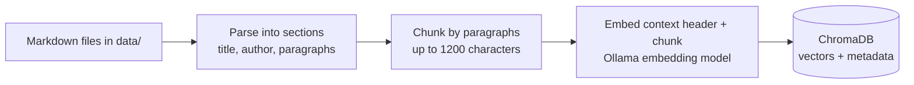
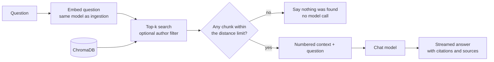

# Knowledge Assistant

> A local-first RAG (Retrieval-Augmented Generation) system: ask questions about your documents and get answers grounded in them, with numbered citations. Built from scratch with Python, Ollama and ChromaDB, **without a RAG framework**.

**Status:** Project 1 of 3 (RAG) is complete. The tool-using agent and the evaluation suite are planned (see the [roadmap](#roadmap)).

---

## Table of contents

- [Why this project exists](#why-this-project-exists)
- [Features](#features)
- [How it works](#how-it-works)
- [Tech stack and why](#tech-stack-and-why)
- [Design decisions in detail](#design-decisions-in-detail)
- [Getting started](#getting-started)
- [Usage](#usage)
- [Input format expected by the parser](#input-format-expected-by-the-parser)
- [Project structure](#project-structure)
- [Configuration](#configuration)
- [Known limitations](#known-limitations)
- [Troubleshooting](#troubleshooting)
- [Roadmap](#roadmap)
- [About the sample corpus](#about-the-sample-corpus)

---

## Why this project exists

This is a learning project with a portfolio goal: understand every piece of a RAG pipeline by building it by hand, instead of hiding it behind a framework.

The plan is a single repository with three layers:

1. **RAG** (this stage): a knowledge base the assistant can search.
2. **Agent**: an agent loop that uses the RAG as one of several tools.
3. **Evals**: automated tests that measure the quality of the first two layers.

Everything runs locally and for free: no API keys, and the documents never leave the machine.

## Features

- **Structure-aware ingestion** of Markdown files: chapters, sections, and message authors are detected from the document itself.
- **Local models** through Ollama for both embeddings and answer generation.
- **Semantic search** with ChromaDB (cosine distance) and **metadata filtering** (for example, only passages signed by a given author).
- **Grounded answers**: the model is instructed to use only the retrieved passages, cite them as `[1]`, `[2]`, and admit when the answer is not in the documents.
- **Source list** printed after every answer, with chapter, section and distance.
- **Guard before the model**: if nothing is close enough to the question, the model is not called at all.
- **Reproducible**: the database is rebuilt from scratch on every ingestion, and the scripts work from any directory.

## How it works

### Ingestion (run once, or whenever the documents change)



1. **Parse**: each file is split into sections using its own structure (headings, `---` separators, signature lines).
2. **Chunk**: whole paragraphs are packed into chunks of up to 1200 characters. A paragraph longer than the limit is split at word boundaries into balanced pieces.
3. **Embed**: each chunk is turned into a vector from `book - chapter / section title / author` plus the chunk text. The stored (and displayed) text is only the clean chunk.
4. **Store**: vectors, texts and metadata (book, chapter, section, author, signature, place and year) are saved in a local ChromaDB collection.

### Question answering



1. The question is embedded with **the same model** used during ingestion.
2. ChromaDB returns the `top-k` closest chunks, optionally restricted by a metadata filter.
3. Chunks farther than `MAX_DISTANCE` are discarded. If none remain, the program says so and stops.
4. The remaining chunks are numbered and sent to the chat model together with the question and a strict system prompt.
5. The answer is streamed to the terminal, followed by the list of sources.

## Tech stack and why

| Component | Choice | Why | Trade-off / alternatives |
|---|---|---|---|
| Language | Python 3.12 | The ecosystem for AI tooling is Python-first, and 3.12 has prebuilt packages for every dependency used here. | Pinned in `.python-version`. Python 3.15 could not install ChromaDB when this was built (see [Troubleshooting](#troubleshooting)). |
| Model runtime | [Ollama](https://ollama.com) | Runs models locally and for free, with one simple API for both embeddings and chat. No keys, no cost, private by default. | Smaller models and slower answers than hosted APIs, especially on CPU. |
| Chat model | `llama3.2:3b` | Small enough (about 2 GB) to run on a laptop CPU, good enough to follow a short grounded prompt. | Weaker instruction following and Portuguese quality than larger models. Changing it is one line in `config.py`. |
| Embedding model | `nomic-embed-text` | Small and fast, with solid retrieval quality. | Trained mostly on English, while the sample corpus is Portuguese. `bge-m3` (multilingual) is the planned alternative to compare with evals. |
| Vector database | [ChromaDB](https://www.trychroma.com) (persistent, local) | Zero setup: it is a Python library that stores everything in a local folder, supports cosine distance and metadata filters. | Not meant for large-scale production. `pgvector` or Qdrant are the natural next step. |
| Distance metric | Cosine | Compares the direction of the vectors, which is what matters for text embeddings. | Configured when the collection is created (`hnsw:space`). |
| Orchestration | Plain Python, no framework | Keeps the pipeline small enough to read in one sitting and forces me to understand each step. | More code than using LangChain or LlamaIndex. A framework comparison is planned for the agent stage. |

## Design decisions in detail

### 1. Chunking by document structure, not by fixed size

The first version split text every 500 characters with a 100-character overlap. It ran, but the results were poor, for three reasons I could see directly in the output:

- chunks started and ended in the **middle of words** (`"mero dos que..."`, from the word *número*);
- the **title and the author's signature ended up in different chunks** from the text they belong to, so a chunk's embedding knew nothing about them;
- a question like *"What are the titles of Erasto's messages?"* could not be answered by any single chunk.

The current version reads the structure of the file: one section is the natural unit, and chunks are built from **whole paragraphs** inside a section. Chunks never cross section boundaries and never cut a word.

Because chunks are built along paragraph boundaries, overlap between chunks is not used. Whether overlap or a different `max_chars` helps is a question for the evals, not for guessing.

### 2. A context header inside the embedding

Each chunk is embedded as:

```
O Evangelho segundo o Espiritismo - Capítulo XXI — ...
Os falsos profetas da erraticidade
Autor: Erasto

<chunk text>
```

The header gives the vector the book, the section title and the author, so a question mentioning an author or a section title lands near the right chunks. The header is **not** stored as the chunk's text, so the printed passages stay clean. This is a common technique known as contextual chunk headers.

### 3. Metadata and filtering instead of asking similarity to do everything

Vector search answers "which passages are about this?". It does not answer enumeration questions such as "list every message by Erasto". For that, each chunk carries structured metadata, and two tools use it:

- `search.py --author Erasto` restricts the search to chunks signed by that author **before** comparing vectors.
- `list_sections.py --author Erasto` lists the sections deterministically from the metadata, with no model involved.

This also prepares the next stage: in the agent, `list_sections` becomes a tool the model can choose when a question is about enumeration rather than content.

### 4. A distance threshold before the model

A vector search **always** returns the closest chunks, even when nothing is relevant. If those chunks were sent to the model, it could build a convincing answer from unrelated text. So chunks above `MAX_DISTANCE` are dropped, and when nothing is left the model is never called.

`MAX_DISTANCE = 0.7` is an initial value, not a calibrated one. The right value depends on the embedding model, so it has to be tuned by comparing distances for questions that do and do not have answers in the documents (planned with the evals).

### 5. Prompt design

The system prompt has four rules, each aimed at a known failure mode:

| Rule | Failure it prevents |
|---|---|
| Use **only** the provided context | Answers from the model's general knowledge instead of the documents |
| Cite sources as `[1]`, `[2]` | Answers that cannot be traced back |
| Say so when the context lacks the answer | Hallucination when retrieval fails |
| Answer in the question's language | Answers in English to Portuguese questions |

Chunks are numbered in the context so the model can cite them, and the printed source list comes from the actual retrieval result, not from the model. A listed source is always a passage that was really retrieved. What the model can still get wrong is **which** number it cites, which is exactly what the evals are meant to measure.

### 6. Rebuild on every ingestion

`ingest.py` deletes and recreates the collection each time. It is simple and idempotent: no stale chunks after changing the chunk size, the embedding model or the parser. The cost is re-embedding everything, which is fine for a small corpus. Incremental ingestion (only changed files) is a future improvement.

### 7. No framework

LangChain or LlamaIndex would shorten the code, but they hide exactly the parts worth understanding: chunking, embedding, retrieval, prompt construction. The whole pipeline here is a few hundred lines. Comparing the hand-written version with a framework is planned for the agent stage.

### 8. Paths that do not depend on the working directory

All paths are computed in `src/config.py` from the location of the file itself. An early version used relative paths, and running a script from the wrong folder silently created an empty database there. Now every script works from any directory.

## Getting started

### Prerequisites

- Linux, macOS or Windows with [Ollama](https://ollama.com) installed (developed and tested on Fedora Linux)
- Python 3.12
- Roughly 3 GB of free disk space for the models

### 1. Clone and create the environment

```bash
git clone https://github.com/CarvalhoGLC/Knowledge-assistant.git
cd Knowledge-assistant

python3.12 -m venv .venv
source .venv/bin/activate
pip install -r requirements.txt
```

If Python 3.12 is not installed, [uv](https://docs.astral.sh/uv/) can provide it:

```bash
uv venv --python 3.12 .venv
source .venv/bin/activate
uv pip install -r requirements.txt
```

### 2. Install the models

```bash
ollama pull llama3.2:3b
ollama pull nomic-embed-text
```

### 3. Add your documents

Put Markdown files in `data/` (see [the expected format](#input-format-expected-by-the-parser)). If a file name is not listed in `BOOK_TITLES` in `src/config.py`, the file name is used as the book title.

### 4. Build the database

```bash
python src/ingest.py
```

### 5. Ask a question

```bash
python src/ask.py "Your question here"
```

## Usage

| Command | What it does |
|---|---|
| `python src/ingest.py` | Parses, chunks, embeds and stores all files in `data/` (rebuilds the database) |
| `python src/ask.py "question"` | Full RAG: retrieval, grounded answer streamed to the terminal, list of sources |
| `python src/search.py "question"` | Retrieval only: shows the closest chunks and their distances (useful for debugging) |
| `python src/list_sections.py` | Lists the stored sections, optionally filtered by author |
| `python src/chat.py` | Plain terminal chat with conversation memory and streaming (not connected to the RAG) |

Options for `ask.py` and `search.py`:

| Option | Meaning |
|---|---|
| `--author NAME` | Only use sections signed by this author |
| `--top-k N` | How many chunks to retrieve |
| `--max-distance X` | Ignore chunks farther than X (`ask.py` only). A large value, such as 5, effectively disables the filter |

Example:

```bash
python src/ask.py --author Erasto "What characteristics does the true prophet have?"
```

The output has this shape: the answer is streamed with citations such as `[1]`, followed by the sources.

```
AI: <answer, citing passages as [1], [2]>

Sources:
[1] O Evangelho segundo o Espiritismo | Capítulo XXI — Haverá falsos cristos e falsos profetas | Caracteres do verdadeiro profeta (distance=0.xxx)
[2] ...
```

## Input format expected by the parser

The parser in `src/ingestion/parsing.py` is written for Markdown with this structure:

````markdown
<h1 align="center"> Chapter title </h1>

## Section title.

1. Numbered paragraphs, or plain paragraphs...

---

# Part title (applies to the sections below it)

## Another section title.

Text of the message...

**Author name.** \
**City, year.**

---
````

| Element | Meaning |
|---|---|
| `<h1>...</h1>` | Chapter title (stored as `chapter`) |
| `## Title.` | Section title (stored as `section`) |
| `---` on its own line | Separates sections |
| `# Title.` | A part that applies to the following sections (stored as `part`) |
| Two bold lines ending the section: `**Author.** \` then `**Place, year.**` | The signature, split into `author`, `signature` and `place_year` |

A section without a `##` heading uses the chapter title. Files with a different layout need an adapted parser.

## Project structure

```
knowledge-assistant/
├── data/                      # Markdown documents to ingest
├── examples/
│   └── embeddings_demo.py     # Embeddings and cosine similarity, step by step
├── src/
│   ├── config.py              # Paths, model names and retrieval settings
│   ├── ingestion/
│   │   ├── parsing.py         # Markdown -> sections with metadata
│   │   └── chunking.py        # Sections -> chunks (paragraph packing)
│   ├── ingest.py              # Parse, chunk, embed and store
│   ├── rag.py                 # Retrieval, prompt construction, streaming answer
│   ├── ask.py                 # CLI: question -> answer with sources
│   ├── search.py              # CLI: retrieval only
│   ├── list_sections.py       # CLI: list sections by metadata
│   ├── chat.py                # Terminal chat with memory (learning step)
│   └── hello_llm.py           # First model call (learning step)
├── .python-version            # Pinned Python version
├── requirements.txt
└── README.md
```

The local database lives in `chroma_db/` and is ignored by Git.

## Configuration

Everything configurable is in `src/config.py`:

| Setting | Default | Meaning |
|---|---|---|
| `EMBED_MODEL` | `nomic-embed-text` | Embedding model. **Re-run `ingest.py` after changing it**, because vectors from different models cannot be mixed |
| `CHAT_MODEL` | `llama3.2:3b` | Model that writes the answer |
| `TOP_K` | `4` | How many chunks are sent to the model |
| `MAX_DISTANCE` | `0.7` | Chunks farther than this are ignored (lower is stricter) |
| `BOOK_TITLES` | two entries | Friendly book names for the files in `data/` |

The chunk size (`max_chars`, default 1200) is a parameter of `chunk_paragraphs` in `src/ingestion/chunking.py`.

## Known limitations

Documented on purpose: knowing where the system fails is part of the project.

- **Enumeration questions are not solved by similarity.** "List all messages by X" needs the metadata tools (`--author`, `list_sections.py`). Choosing automatically between search and listing is the job of the planned agent.
- **The chat model is small.** With a 3B model, answers can be shallow, miss details, or drift from the instructions, especially in Portuguese.
- **Citations can be wrong.** The source list is always real, but the model may attach the wrong number to a claim. There is no automatic check yet.
- **`MAX_DISTANCE` is not calibrated.** The default is a starting point.
- **Chunk size and `TOP_K` are not tuned.** They are reasonable defaults, not measured optima.
- **The embedding model is English-centric.** Retrieval quality on Portuguese text may improve with a multilingual model.
- **Single-turn.** `ask.py` has no conversation memory, and there is no query rewriting, hybrid (keyword plus vector) search or reranking.
- **Parser tied to one layout.** It expects the Markdown format described above.
- **Context window.** If too many chunks are sent, the prompt may exceed the model's context window and be silently truncated. That is why `TOP_K` is small.

## Troubleshooting

**`Error: 500 ... ErrorDeviceLost` when running a model.** Ollama's GPU backend (Vulkan) crashed. Force CPU mode by running `sudo systemctl edit ollama`, adding the lines below, then `sudo systemctl daemon-reload && sudo systemctl restart ollama`:

```ini
[Service]
Environment="OLLAMA_LLM_LIBRARY=cpu"
Environment="OLLAMA_VULKAN=0"
```

**`pip install` fails trying to compile numpy, or with `ResolutionImpossible`.** The Python version is too new for some dependency. When this project was built, `onnxruntime` (required by ChromaDB) had no packages for Python 3.15. Use Python 3.12 (`.python-version`).

**`Collection [documents] does not exist`.** Run `python src/ingest.py` first.

**Answers say nothing was found for questions that should work.** The distance limit may be too strict for your embedding model. Run with `--max-distance 5` to see the real distances, then adjust `MAX_DISTANCE`.

## Roadmap

- [x] Terminal chat with memory and streaming
- [x] Embeddings and semantic search
- [x] Structure-aware ingestion with metadata
- [x] Grounded answers with citations
- [ ] **Evals**: question dataset with expected sources, retrieval hit rate, answer faithfulness with LLM-as-judge
- [ ] Use the evals to tune chunk size, `TOP_K`, `MAX_DISTANCE`, and to compare `nomic-embed-text` with `bge-m3`
- [ ] **Agent** with a hand-written tool-calling loop (`search_knowledge_base`, `list_sections` and more), then the same agent with a framework for comparison
- [ ] Hybrid search and reranking
- [ ] Evals in CI with GitHub Actions
- [ ] `docker compose up` to run everything

## About the sample corpus

The example documents are two chapters of works by Allan Kardec, in Portuguese: a chapter of *O Evangelho segundo o Espiritismo* and a chapter of *O Livro dos Médiuns*. The pipeline is not specific to them. If you add your own texts, check the license of the edition you use before redistributing the files.